  

<h1 align="center">Hi, I'am Tasnim Jabir 👋</h1>

<strong>AI/ML Engineer | Cybersecurity</strong>

  
  
  
  
  

<h2 align="center">About Me</h2>

<strong>
🎓 I'm studying at East West University. 
📍 I live in Dhaka, Bangladesh. 
💻 I build AI-powered applications that combine machine learning, reliable backend systems, and thoughtful design. 
🧠 I'm currently learning Computer vision, Gen AI, LLM, Multimodel ai, AI agents. 
🎨 I'm also passionate in design, art and graphics. It helps me bring creativity in my works.
</strong>

---

<h2 align="center">Stacks</h2>

<table align="center" border="1" frame="box" rules="none">
  <tr>
    <th align="center" valign="middle">Languages</th>
    <td align="center">
      <table align="center">
        <tr>
          <td align="center" width="56"></td>
          <td align="center" width="56"></td>
          <td align="center" width="56"></td>
        </tr>
        <tr>
          <td align="center">C++</td>
          <td align="center">Java</td>
          <td align="center">Python</td>
        </tr>
      </table>
    </td>
  </tr>
  <tr>
    <th align="center" valign="middle">Databases</th>
    <td align="center">
      <table align="center">
        <tr>
          <td align="center" width="56"></td>
          <td align="center" width="56"></td>
          <td align="center" width="56"></td>
          <td align="center" width="56"></td>
        </tr>
        <tr>
          <td align="center">MySQL</td>
          <td align="center">Oracle</td>
          <td align="center">PostgreSQL</td>
          <td align="center">MongoDB</td>
        </tr>
      </table>
    </td>
  </tr>
  <tr>
    <th align="center" valign="middle">AI / ML</th>
    <td align="center">
      <table align="center">
        <tr>
          <td align="center" width="56"></td>
          <td align="center" width="56"></td>
          <td align="center" width="56"></td>
          <td align="center" width="56"></td>
          <td align="center" width="56"></td>
        </tr>
        <tr>
          <td align="center">PyTorch</td>
          <td align="center">TensorFlow</td>
          <td align="center">scikit-learn</td>
          <td align="center">OpenCV</td>
          <td align="center">Hugging Face</td>
        </tr>
      </table>
    </td>
  </tr>
  <tr>
    <th align="center" valign="middle">Frontend</th>
    <td align="center">
      <table align="center">
        <tr>
          <td align="center" width="56"></td>
          <td align="center" width="56"></td>
          <td align="center" width="56"></td>
          <td align="center" width="56"></td>
        </tr>
        <tr>
          <td align="center">HTML5</td>
          <td align="center">CSS3</td>
          <td align="center">JavaScript</td>
          <td align="center">React</td>
        </tr>
      </table>
    </td>
  </tr>
  <tr>
    <th align="center" valign="middle">Backend</th>
    <td align="center">
      <table align="center">
        <tr>
          <td align="center" width="56"></td>
          <td align="center" width="56"></td>
          <td align="center" width="56"></td>
          <td align="center" width="56"></td>
        </tr>
        <tr>
          <td align="center">Django</td>
          <td align="center">Flask</td>
          <td align="center">PHP</td>
          <td align="center">FastAPI</td>
        </tr>
      </table>
    </td>
  </tr>
  <tr>
    <th align="center" valign="middle">Data Science</th>
    <td align="center">
      <table align="center">
        <tr>
          <td align="center" width="56"></td>
          <td align="center" width="56"></td>
          <td align="center" width="56"></td>
          <td align="center" width="56"></td>
        </tr>
        <tr>
          <td align="center">NumPy</td>
          <td align="center">Pandas</td>
          <td align="center">Matplotlib</td>
          <td align="center">Jupyter</td>
        </tr>
      </table>
    </td>
  </tr>
  <tr>
    <th align="center" valign="middle">Deployment &amp; DevOps</th>
    <td align="center">
      <table align="center">
        <tr>
          <td align="center" width="56"></td>
          <td align="center" width="56"></td>
          <td align="center" width="56"></td>
          <td align="center" width="56"></td>
          <td align="center" width="56"></td>
        </tr>
        <tr>
          <td align="center">Linux</td>
          <td align="center">Ubuntu</td>
          <td align="center">Nginx</td>
          <td align="center">Apache</td>
          <td align="center">Docker</td>
        </tr>
      </table>
    </td>
  </tr>
  <tr>
    <th align="center" valign="middle">Developer Tools</th>
    <td align="center">
      <table align="center">
        <tr>
          <td align="center" width="56"></td>
          <td align="center" width="56"></td>
          <td align="center" width="56"></td>
        </tr>
        <tr>
          <td align="center">Git</td>
          <td align="center">GitHub</td>
          <td align="center">VS Code</td>
        </tr>
      </table>
    </td>
  </tr>
  <tr>
    <th align="center" valign="middle">Creative Tools</th>
    <td align="center">
      <table align="center">
        <tr>
          <td align="center" width="56"></td>
          <td align="center" width="56"></td>
          <td align="center" width="56"></td>
          <td align="center" width="56"></td>
          <td align="center" width="56"></td>
          <td align="center" width="56"></td>
          <td align="center" width="56"></td>
          <td align="center" width="56"></td>
        </tr>
        <tr>
          <td align="center">Blender</td>
          <td align="center">Photoshop</td>
          <td align="center">Illustrator</td>
          <td align="center">Premiere Pro</td>
          <td align="center">After Effects</td>
          <td align="center">Figma</td>
          <td align="center">Spline</td>
          <td align="center">AutoCAD</td>
        </tr>
      </table>
    </td>
  </tr>
</table>

<h2 align="center">GitHub Stats</h2>

  

  
  

  
  

  

